<div align="center">


# Urasicous Clean Tech

**Lights that stay on for village homes, from a solar grid the village owns.**

An eight-page website, with a guided tour for judges and a live, simulated control room, for a community solar microgrid<br>serving **50 households in Rampur Kheda**, a farming village 38 km from Nashik, Maharashtra.


[**Credits**](#credits) · [**Judge's tour**](#tour) · [**The project**](#project) · [**Innovation**](#innovation) · [**Live dashboard**](#dashboard) · [**Finances**](#finances) · [**Run it**](#run) · [**Contact**](#contact)

</div>

---

<a id="credits"></a>

## 👥 Credits

<table>
<tr>
<td width="50%" valign="top">

### The project
**Team Pioneering Sol-Gen**<br>
for HCL Jigsaw · Edition 7 · Grade 9<br>
Climate Action & Sustainable Energy

All of the work is theirs: the village research, load calculations, system sizing, cost analysis, distribution sketch, governance model and pitch. It is in their worksheet: [`Village-Microgrid-Project-Report.pptx`](assets/Village-Microgrid-Project-Report.pptx).

</td>
<td width="50%" valign="top">

### The website
Built by **Roushan** · [@Roushan-2104](https://github.com/Roushan-2104)

I designed and built this website to present the team's project. The ideas, research and content belong to Team Pioneering Sol-Gen.

</td>
</tr>
</table>

---

<a id="tour"></a>

## 🧭 The judge's tour

The site is split into eight short pages, one idea each, so a judge can go through it in order or jump straight to what they want to see.

| Step | Page | What's on it |
| :---: | --- | --- |
| 1 | [`index.html`](index.html) **Home** | The problem in one line, live figures, yearly impact, UN SDG badges and a card for every other page |
| 2 | [`village.html`](village.html) **The village & the need** | Rampur Kheda, the five-household power-cut survey, and how the grid was sized |
| 3 | [`system.html`](system.html) **How it works** | Generate → store → distribute, with the hardware for each stage |
| 4 | [`innovation.html`](innovation.html) **Innovation** | Smart agrivoltaics, and AI Weather Forecast Mode |
| 5 | [`dashboard.html`](dashboard.html) **Live dashboard** | The simulated control room, with the AI switch |
| 6 | [`finances.html`](finances.html) **Finances** | The ₹36.1 lakh bill, who pays, and the plan to reach all 480 homes |
| 7 | [`governance.html`](governance.html) **Run by the village** | The elected committee, fees, repairs and the tough questions |
| 8 | [`prototype.html`](prototype.html) **Prototype & report** | Sketch plan, cardboard model, its ₹490 bill and the full report |

**Finding the way:**
- A sticky **menu bar** on every page highlights where you are, with *Live dashboard* always in yellow. On phones it becomes a numbered menu.
- Every page header shows **"Step X of 8"**.
- A **tour bar** at the bottom of every page has *Previous* / *Next* buttons and eight dots for jumping to any step.
- Technical words (kWp, LiFePO4, MGCC, BMS, net metering, PM-KUSUM…) have a **dotted underline**. Tap or hover for a plain-English meaning.

<table>
<tr>
<td width="68%" valign="top">
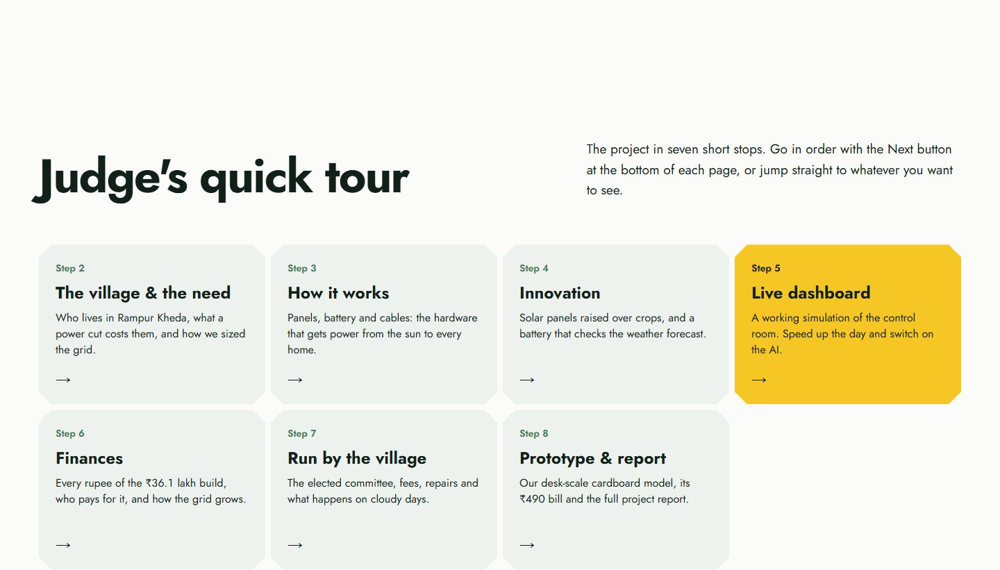

</td>
<td width="32%" valign="top">
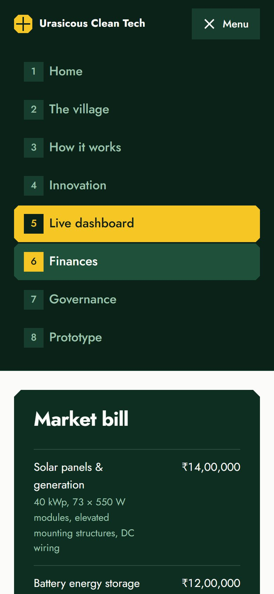
<div align="center"><sub>The menu on a phone</sub></div>
</td>
</tr>
</table>

---

<a id="project"></a>

## 🌾 The project

<table>
<tr>
<td width="55%" valign="top">

Rampur Kheda has **2,400 people in 480 households**. They grow wheat and cotton and run a small dairy, a flour mill and a few shops. The power goes out for **4–6 hours a day, up to 8 in summer**. Families who can afford it start up diesel generators, and everyone else waits in the dark.

The team designed a **community-owned solar microgrid**. Its first phase covers 50 homes and is built so the rest of the village can join later.

</td>
<td width="45%" valign="top">

<sub>A village in Nashik district, the region Rampur Kheda is set in.</sub>
</td>
</tr>
</table>

<div align="center">

| ☀️ Solar array | 🔋 Battery storage | 🏠 Homes | 💰 Per household | ⏱️ Payback |
| :---: | :---: | :---: | :---: | :---: |
| **40 kWp** | **90 kWh** | **50** | **₹1,200** | **< 3 years** |
| 73 × 550 W panels, raised over crops | LiFePO4 + MGCC | phase one of 480 | paid once | projected |

</div>


### What changes for the village

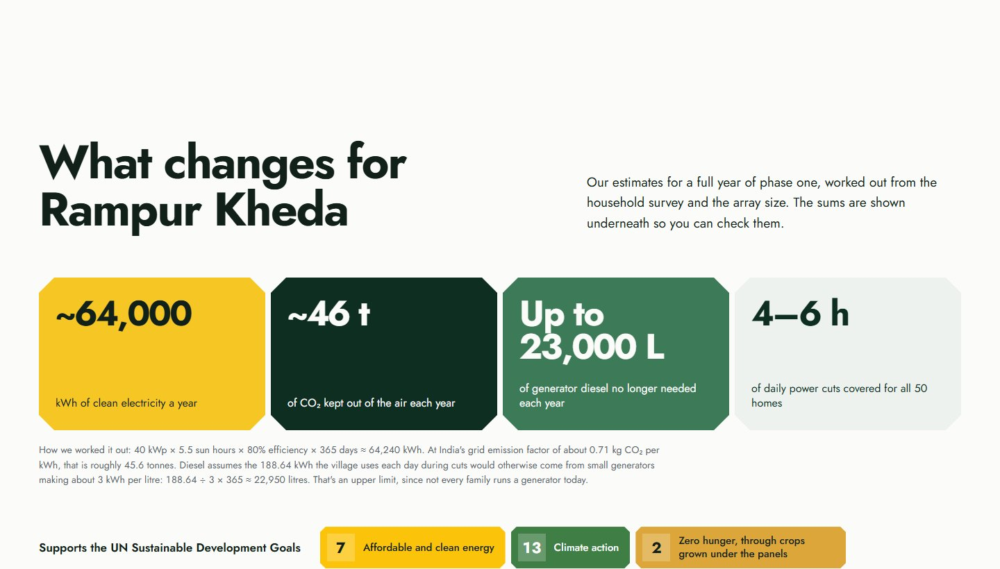

| Per year (estimates) | | How it's worked out |
| --- | ---: | --- |
| ⚡ Clean electricity | **~64,000 kWh** | 40 kWp × 5.5 sun hours × 80% × 365 days ≈ 64,240 kWh |
| 🌍 CO₂ avoided | **~46 t** | 64,240 kWh × ~0.71 kg CO₂ per kWh (India's grid emission factor) |
| 🛢️ Diesel no longer needed | **up to 23,000 L** | 188.64 kWh a day during cuts ÷ ~3 kWh per litre × 365. An upper limit, since not every family runs a generator today. |

**UN Sustainable Development Goals:** 🟨 **7** Affordable and clean energy · 🟩 **13** Climate action · 🟧 **2** Zero hunger, through the crops grown under the panels.

### How the team sized it

The team sat down with five typical households, wrote down everything they run during a power cut, scaled the average up to 50 homes, and added 20% for street lights and the shared water pump.

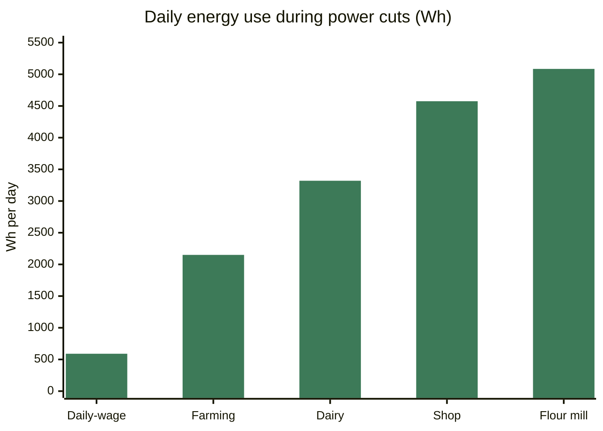

| Household | Appliances during cuts | Daily use |
| --- | --- | ---: |
| Farming family | Water pump 750 W × 2 h · 3 bulbs 15 W × 4 h · fan 75 W × 6 h · phone 10 W × 2 h | 2,150 Wh |
| Shop owners | 2 tube lights 40 W × 5 h · fridge 150 W × 24 h · fan 75 W × 5 h · TV 100 W × 2 h | 4,575 Wh |
| Dairy farmers | Milk chiller 500 W × 4 h · 2 bulbs 15 W × 4 h · fan 75 W × 6 h · pump 750 W × 1 h | 3,320 Wh |
| Flour mill | Mill motor 1,500 W × 3 h · 3 bulbs 15 W × 4 h · fan 75 W × 5 h · phone 10 W × 3 h | 5,085 Wh |
| Daily-wage family | 2 bulbs 15 W × 4 h · fan 75 W × 6 h · phone 10 W × 2 h | 590 Wh |

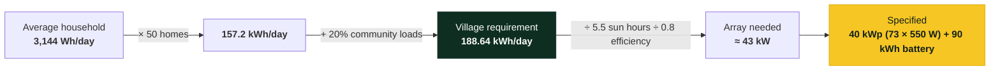

---

<a id="innovation"></a>

## 💡 Innovation

### 1 · Smart agrivoltaics: panels above, crops below

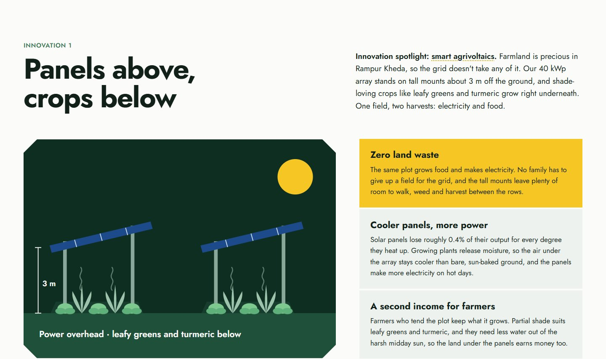

The 40 kWp array stands on tall mounts **about 3 m off the ground**, and shade-loving crops such as **leafy greens and turmeric** grow right underneath. One field, two harvests: electricity and food.

| | Benefit |
| --- | --- |
| 🌱 **Zero land waste** | The same plot grows food and makes electricity. No family has to give up a field for the grid. |
| 🌡️ **Cooler panels, more power** | Panels lose roughly 0.4% of their output per °C. Plants release moisture, so the air under the array stays cooler than bare ground and the panels produce more on hot days. |
| 💵 **A second income for farmers** | Farmers who tend the plot keep what it grows. Partial shade suits greens and turmeric, and they need less water out of the midday sun. |

### 2 · AI Weather Forecast Mode: a battery that checks the weather

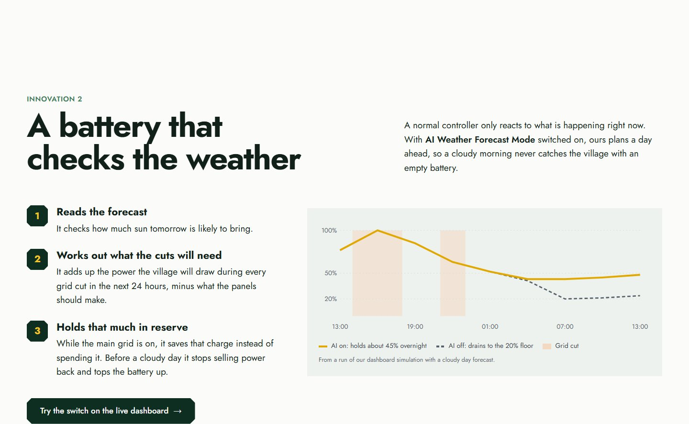

A normal controller only reacts to what's happening now. With AI Weather Forecast Mode switched on, the controller plans a day ahead:

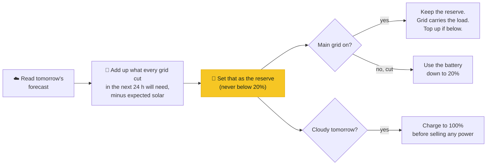

In a run of the simulation with a cloudy day forecast, the battery **stays around 45% overnight** with AI on, but **drains to its 20% floor** with AI off.

---

<a id="dashboard"></a>

## 📡 The live dashboard

A control room that runs a **simulated day in Rampur Kheda**, minute by minute, starting at the visitor's own clock time. The home page shows the same live figures.


<table>
<tr>
<td width="62%" valign="top">

| Panel | What it shows |
| --- | --- |
| ☀️ **Solar generation** | Live kW output, energy generated today, and a chart of today's output against village load |
| 🔋 **Battery storage** | Charge level, kWh stored, charging or supplying, hours of backup, tomorrow's forecast, the reserve being held, and a **24-hour projected battery curve** compared against the other mode |
| 💹 **Net metering** | Earnings from selling power to the grid, kWh exported, and grid status (connected, exporting, or cut and islanded) |
| 🏠 **Household grid** | House #01–#50, laid out as the 50 cells of one solar panel, each with live draw and prepaid-meter status. Tap a house to read its meter |

**Controls:** `Real time` · `1 min / sec` · `Day in 2 min` · **`AI Weather Forecast Mode`** on / off

</td>
<td width="38%" valign="top">

<div align="center"><sub>On a phone</sub></div>
</td>
</tr>
</table>

### What the simulation models

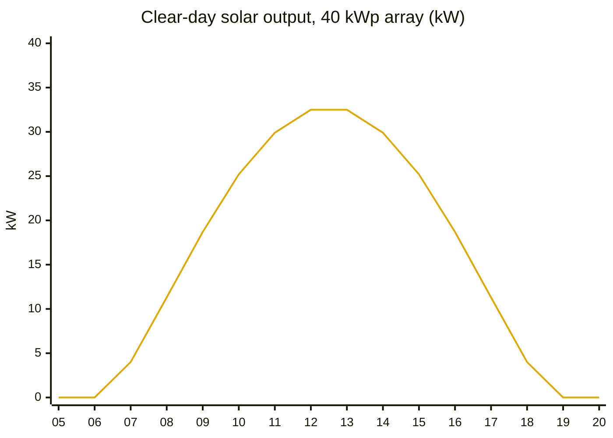

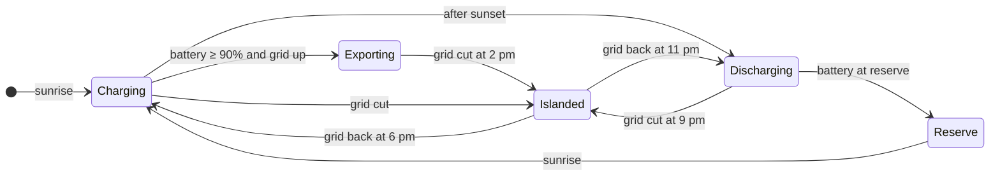

- **Clock:** the simulated day starts at the visitor's local time, so the home page and dashboard agree. Speed it up to watch a whole day.
- **Solar:** a sun curve from about 06:15 to 18:45 at 82% system efficiency, with drifting clouds.
- **Weather:** a repeating six-day monsoon pattern, from sunny to heavily overcast, which sets each day's sunshine and the next day's forecast.
- **Loads:** the five surveyed household types, using their real appliance wattages and hours, spread across 50 homes, plus street lights and the shared water pump.
- **Battery:** 90 kWh, 92% round-trip efficiency, 20% reserve floor, 45 kW maximum charge rate.
- **Grid cuts:** 14:00–18:00 and 21:00–23:00. During a cut the microgrid islands and the battery carries every home.
- **Net metering:** surplus above 90% charge is exported at ₹3.10/kWh. With AI on and a cloudy day ahead, the battery fills to 100% first.
- **AI Weather Forecast Mode:** holds a reserve sized to the next 24 hours of cuts and tops up from the grid at up to 6 kW when it falls below.
- **Prepaid meters:** balances fall at ₹5.00/kWh. Two homes start low so the recharge warning shows.

> [!NOTE]
> All dashboard data is **simulated** for demonstration. The tariffs, weather and cut schedule are modelling assumptions, not measured figures.

---

<a id="system"></a>

## ⚙️ How the microgrid works

Power flows one way: from the panels, through the central power house, out to every meter.


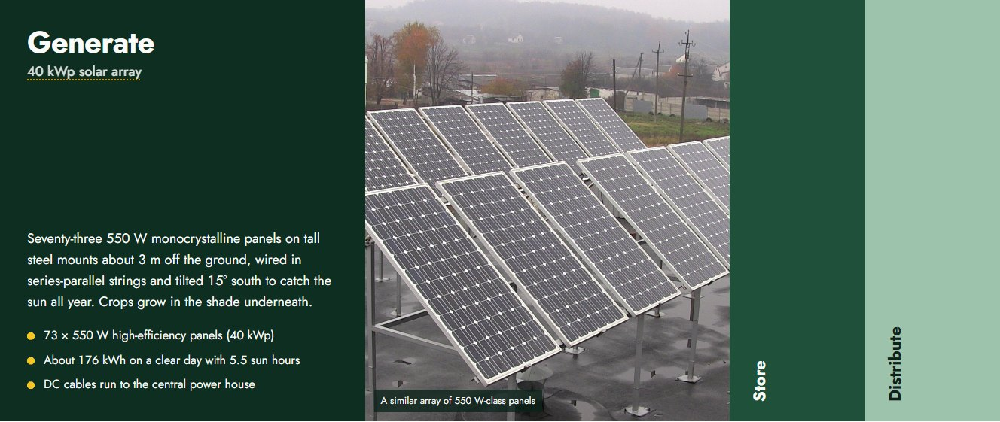

<table>
<tr>
<td width="33%" valign="top">


**Generate**<br>
73 × 550 W monocrystalline panels on steel mounts about 3 m high, with crops growing underneath. Series-parallel strings tilted 15° south. About 176 kWh on a clear day.
</td>
<td width="33%" valign="top">


**Store**<br>
90 kWh LiFePO4 bank with an integrated BMS. Round trip above 92%, switch-over under 20 ms, run by the MGCC.
</td>
<td width="33%" valign="top">


**Distribute**<br>
Armoured cables to every lane. Each home gets a smart prepaid meter, MCB and ELCB, with lightning arresters and earthing throughout.
</td>
</tr>
</table>

### The team's layout sketch

<div align="center">

<br><sub>Hand-drawn by Team Pioneering Sol-Gen: generation zone, central power house, and the AC backbone on poles and underground to every home.</sub>
</div>

---

<a id="finances"></a>

## 💰 Financial transparency


<table>
<tr>
<td width="50%" valign="top">

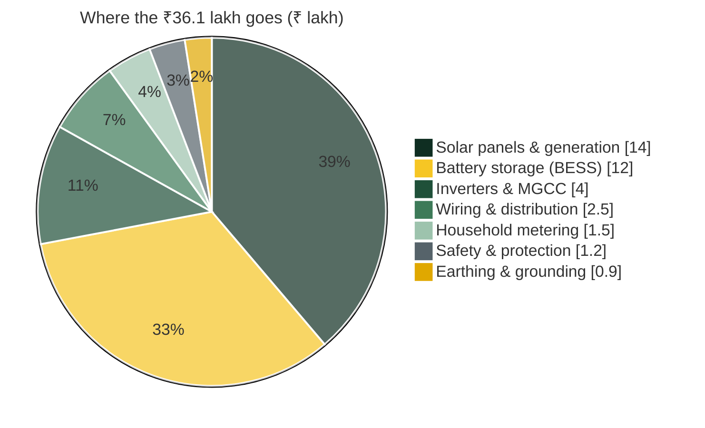

</td>
<td width="50%" valign="top">

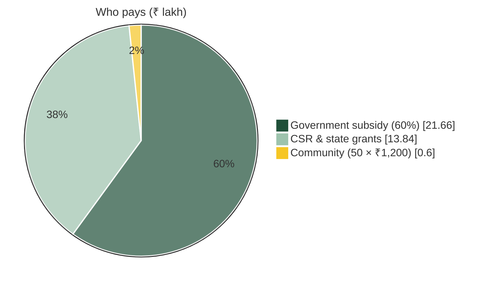

</td>
</tr>
</table>

| Item | Detail | Cost |
| --- | --- | ---: |
| Solar panels & generation | 40 kWp, 73 × 550 W modules, elevated mounting structures, DC wiring | ₹14,00,000 |
| Battery energy storage | 90 kWh LiFePO4 bank with BMS | ₹12,00,000 |
| Inverters & control (MGCC) | Microgrid Central Controller and power conversion | ₹4,00,000 |
| Wiring & distribution | Armoured backbone cable, poles, service lines | ₹2,50,000 |
| Household metering | 50 smart prepaid meters, MCBs, ELCBs, drop lines | ₹1,50,000 |
| Safety & protection | MCCBs, fuse cut-outs, surge protection, lightning arresters | ₹1,20,000 |
| Earthing & grounding | Earth pits, pole earth rods, household electrodes | ₹90,000 |
| **Total gross capital cost** | | **₹36,10,000** |
| − Government subsidy, 60% | PM-KUSUM / rural schemes | ₹21,66,000 |
| − CSR & state grants | | ₹13,84,000 |
| **= Community share** | **50 homes × ₹1,200** | **₹60,000** |

The grid is expected to pay for itself in **under 3 years**, through money earned selling power back to the grid and the diesel families no longer buy. After that, export income goes into the maintenance fund.

### Room to grow

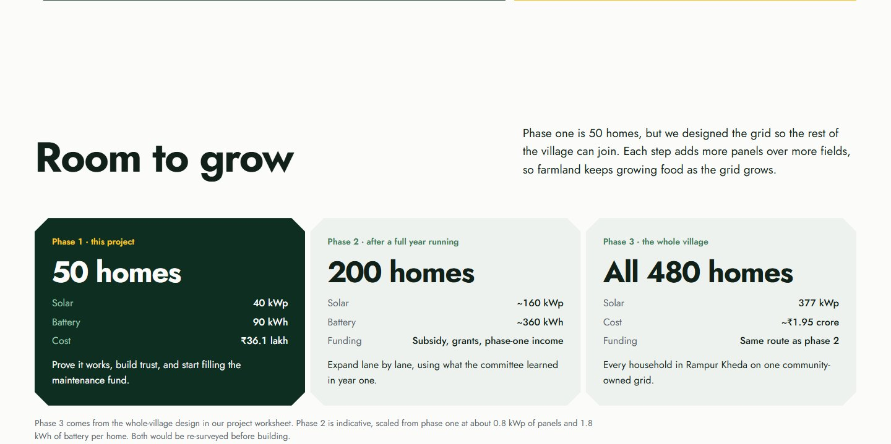

| Phase | Homes | Solar | Battery / cost | Notes |
| --- | ---: | ---: | --- | --- |
| **1 · this project** | 50 | 40 kWp | 90 kWh · ₹36.1 lakh | Prove it works, build trust, start the maintenance fund |
| **2 · after a year running** | 200 | ~160 kWp | ~360 kWh | Indicative, scaled from phase one (~0.8 kWp and ~1.8 kWh per home) |
| **3 · the whole village** | 480 | 377 kWp | ~₹1.95 crore | From the whole-village design in the team's worksheet |

---

## 🤝 Run by the village

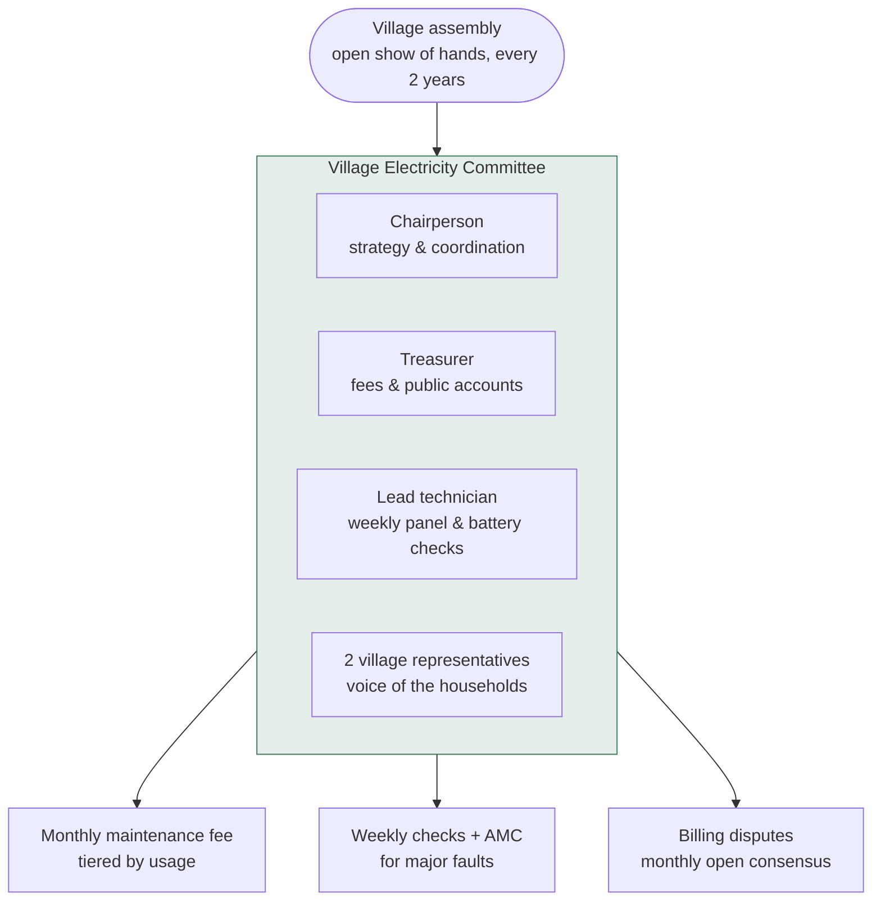

<details>
<summary><b>❓ The tough questions from the pitch</b></summary>

<br>

**What happens during the monsoon or on cloudy days?**<br>
The battery always keeps some charge in reserve for dull days, and monocrystalline panels still catch plenty of light through cloud. During long grey spells the battery tops up from the main grid whenever it's available. With AI Weather Forecast Mode on, the controller sees the clouds coming and saves extra charge a day ahead.

**What if a family can't pay on time?**<br>
Smart prepaid meters simply pause supply when the credit runs out, so nobody piles up debt. If a family is going through a hard time, the committee sorts it out openly, neighbour to neighbour.

**Who fixes breakdowns?**<br>
A local technician trained by the team checks everything once a week. The big equipment is covered by a yearly maintenance contract with a professional service company. Support is also available at [67811urasicousct@gmail.com](mailto:67811urasicousct@gmail.com).

</details>

---

## 🧪 Prototype & report


The prototype page holds the team's **sketch plan**, the **cardboard prototype**, its **material bill**, and a download of the full **project report**.

| Prototype material | Cost |
| --- | ---: |
| Cardboard sheets (3, reused) | ₹0 |
| Mini solar panel, 6 V 1 W (1) | ₹100 |
| 3.7 V Li-ion cell with holder | ₹150 |
| 5 mm LEDs (20) and resistors | ₹60 |
| Mini DC motor fan | ₹80 |
| Toggle switches (2) | ₹30 |
| Hook-up wire and tape | ₹40 |
| Glue (from home) | ₹0 |
| Markers | ₹30 |
| **Total** | **₹490** |

---

## 🖥️ The website

<table>
<tr>
<td width="68%" valign="top">

### Design idea
The whole site runs on one shape: the **clipped-corner square of a monocrystalline solar cell**. It forms the buttons, tabs, image masks, tiles and tour dots. In the dashboard, the 50 households become the 50 cells of a single solar panel.

| Colour | Hex | Use |
| --- | --- | --- |
|  Deep forest | `#0b2219` | Menu bar, page headers, dashboard, footer |
|  Forest | `#1f5039` | Fields and panels |
|  Sage | `#9dc3ad` | Secondary fields |
|  Crisp white | `#fbfcfa` | Page ground |
|  Slate | `#56636a` | Secondary text |
|  Solar yellow | `#f6c624` | Actions, live energy, current step |

**Type:** [Jost](https://fonts.google.com/specimen/Jost), a 1920s geometric sans.

</td>
<td width="32%" valign="top">

<div align="center"><sub>Fully responsive</sub></div>
</td>
</tr>
</table>

---

<a id="run"></a>

## 🚀 Running it

The site is plain HTML, CSS and JavaScript, with **no build step and no dependencies**.

```bash
git clone https://github.com/Roushan-2104/Urasicous-Clean-Tech.git
cd Urasicous-Clean-Tech
```

Open `index.html` in any browser and use the menu or the *Next* buttons, or serve the folder:

```bash
python -m http.server 8000
# then open http://localhost:8000
```

### Publish on GitHub Pages

1. Go to **Settings → Pages**.
2. Under **Build and deployment**, choose **Deploy from a branch**, then `main` and `/ (root)`.
3. The site goes live at `https://roushan-2104.github.io/Urasicous-Clean-Tech/`.

### Project structure

```
Urasicous-Clean-Tech/
├── index.html          # 1 · Home: summary, impact, SDGs, judge's tour
├── village.html        # 2 · The village & the need, load survey, sizing
├── system.html         # 3 · How it works: generate, store, distribute
├── innovation.html     # 4 · Agrivoltaics + AI Weather Forecast Mode
├── dashboard.html      # 5 · Live microgrid dashboard (simulation)
├── finances.html       # 6 · Costs, who pays, scaling roadmap
├── governance.html     # 7 · Village Electricity Committee, Q&A
├── prototype.html      # 8 · Desk prototype, bill, project report
├── styles.css          # design tokens, layout, responsive rules
├── sim.js              # microgrid simulation and AI forecast mode (home + dashboard)
├── common.js           # menu, glossary tooltips, accordion, prototype tabs
├── assets/
│   ├── Village-Microgrid-Project-Report.pptx   # the team's worksheet
│   ├── sketch-plan.jpg                          # the team's layout sketch
│   ├── credits.json                             # source + licence of every photo
│   └── *.jpg                                    # openly licensed photographs
└── docs/screenshots/   # images used in this README
```

> [!TIP]
> Each page repeats the same menu bar, tour bar and footer. If you add or rename a page, update those three blocks on every page so the tour stays in step.

---

## 📝 Notes on the figures

- The headline figures (50 homes, 40 kWp, 90 kWh, ₹36.1 lakh, ₹1,200, under 3 years) follow the project brief. The village profile, load survey, battery specifications, governance model and pitch answers come from the team's worksheet.
- The array is **73 × 550 W = 40.15 kWp**, which keeps the specified 40 kWp with 550 W modules.
- The yearly impact figures are estimates, with the working shown above. The diesel figure is an upper limit.
- The worksheet's whole-village design (480 homes, 377 kWp, about ₹1.95 crore) is used as phase 3 of the roadmap. Phase 2 is an indicative estimate scaled from phase one.
- The itemised bill splits ₹36.1 lakh across components at estimated market rates. The 60% subsidy is applied to the gross cost.
- The cardboard prototype appears as a drawing, and its material bill (₹490) is a sample. Both are to be replaced with the team's real photo and bill.
- The project report (`.pptx`) still shows the earlier 80 × 500 W panels and prototype bill.

---

<a id="contact"></a>

## ✉️ Contact & support

**Email:** [67811urasicousct@gmail.com](mailto:67811urasicousct@gmail.com)

---

## 📷 Image credits

The photographs show the wider world of the project, not the project itself. All are from Wikimedia Commons under open licences:

| Photo | Author | Licence |
| --- | --- | --- |
| [Traditional House Solar, Zamtang, Zanskar](https://commons.wikimedia.org/w/index.php?curid=152914959) | Timothy A. Gonsalves | CC BY-SA 4.0 |
| [Anjenari village, Nashik](https://commons.wikimedia.org/w/index.php?curid=42551914) | Mahi29 | CC BY-SA 4.0 |
| [Rooftop solar power plant](https://commons.wikimedia.org/w/index.php?curid=44112543) | Oleg Savitsky | CC BY-SA 4.0 |
| [Logarex smart household electricity meter](https://commons.wikimedia.org/wiki/File:Logarex_smart_household_electricity_meter_build_year_2023.jpg) | RobbieIanMorrison | CC BY 4.0 |
| [Solar panels closeup](https://commons.wikimedia.org/wiki/File:Solar_panels_closeup.jpg) | Jollyroger | CC BY-SA 2.5 |
| [Bird's eye view of Nashik city](https://commons.wikimedia.org/w/index.php?curid=28498936) | Anannyadeb | CC BY-SA 3.0 |

The sketch plan and project report are the work of Team Pioneering Sol-Gen.

---

<div align="center">


**© 2026 Urasicous Clean Tech** | Developed with passion by **Team Pioneering Sol-Gen** for **HCL Jigsaw**.<br>
<sub>Website built by <a href="https://github.com/Roushan-2104">Roushan</a></sub>

</div>
