<div align="center">

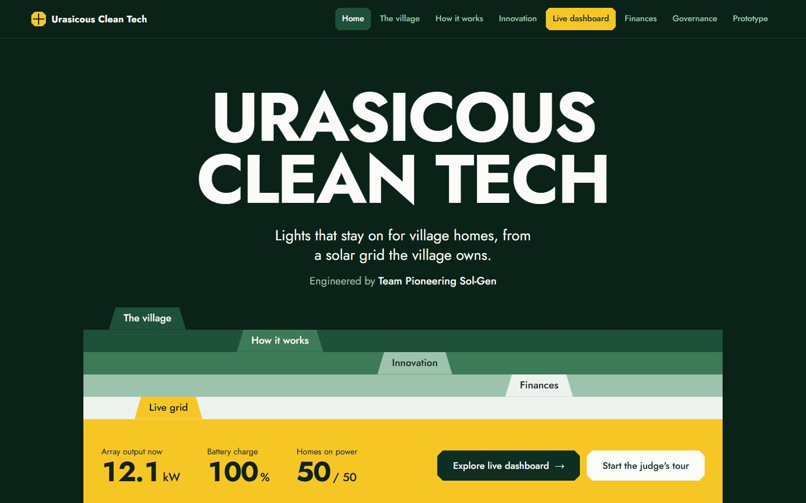

# Urasicous Clean Tech

**Empowering rural communities through next-gen solar microgrids.**

A landing page and live, simulated control-room dashboard for a community solar microgrid<br>serving **50 households in Rampur Kheda**, a farming village 38 km from Nashik, Maharashtra.


[**Credits**](#credits) · [**The project**](#project) · [**Live dashboard**](#dashboard) · [**System**](#system) · [**Finances**](#finances) · [**Run it**](#run)

</div>

---

<a id="credits"></a>

## 👥 Credits

<table>
<tr>
<td width="50%" valign="top">

### The project
**Team Pioneering Sol-Gen**<br>
for HCL Jigsaw · Edition 7 · Grade 9<br>
Climate Action & Sustainable Energy

All of the work is theirs: the village research, load calculations, system sizing, cost analysis, distribution sketch, governance model and pitch. It is in their worksheet: [`Village-Microgrid-Project-Report.pptx`](assets/Village-Microgrid-Project-Report.pptx).

</td>
<td width="50%" valign="top">

### The website
Built by **Roushan** · [@Roushan-2104](https://github.com/Roushan-2104)

I designed and built this website to present the team's project. The ideas, research and content belong to Team Pioneering Sol-Gen.

</td>
</tr>
</table>

---

<a id="project"></a>

## 🌾 The project

<table>
<tr>
<td width="55%" valign="top">

Rampur Kheda has **2,400 people in 480 households**. They grow wheat and cotton and run a small dairy, a flour mill and a few shops. Power cuts last **4–6 hours a day, up to 8 in summer**, and families fall back on noisy, polluting diesel generators while free sunlight goes unused.

The team designed a **community-owned solar microgrid**. Its first phase covers 50 homes and is built to scale out to the whole village.

</td>
<td width="45%" valign="top">
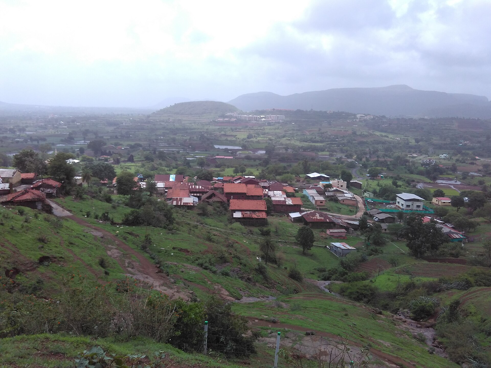
<sub>A village in Nashik district, the region Rampur Kheda is set in.</sub>
</td>
</tr>
</table>

<div align="center">

| ☀️ Solar array | 🔋 Battery storage | 🏠 Homes | 💰 Per household | ⏱️ Payback |
| :---: | :---: | :---: | :---: | :---: |
| **40 kWp** | **90 kWh** | **50** | **₹1,200** | **< 3 years** |
| 80 × 500 W panels | LiFePO4 + MGCC | phase one of 480 | paid once | projected |

</div>

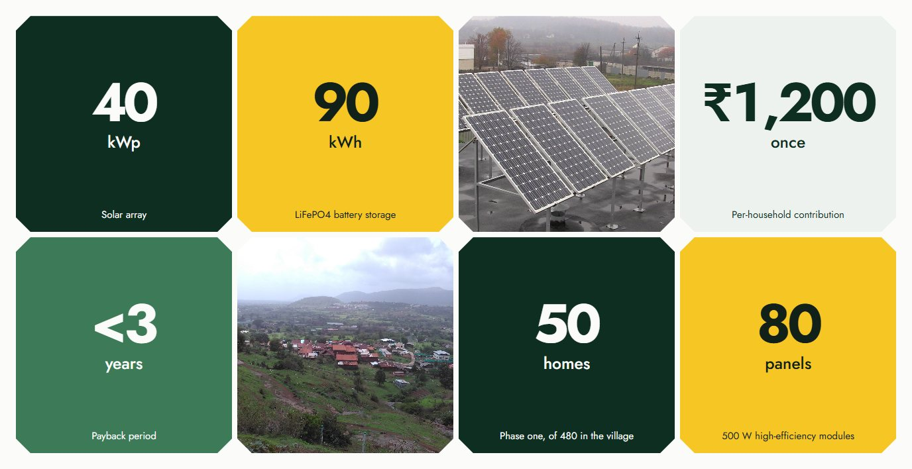

### How the team sized it

The team logged what five typical households run during a power cut, scaled the average to 50 homes, and added 20% for street lights and the shared water pump.

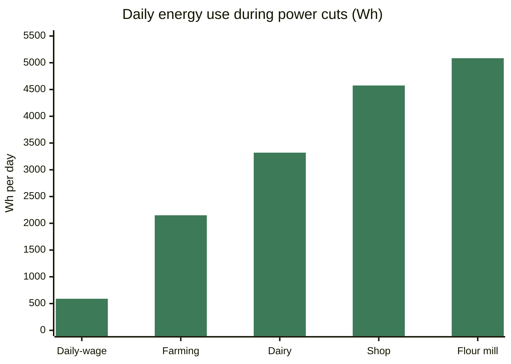

| Household | Appliances during cuts | Daily use |
| --- | --- | ---: |
| Farming family | Water pump 750 W × 2 h · 3 bulbs 15 W × 4 h · fan 75 W × 6 h · phone 10 W × 2 h | 2,150 Wh |
| Shop owners | 2 tube lights 40 W × 5 h · fridge 150 W × 24 h · fan 75 W × 5 h · TV 100 W × 2 h | 4,575 Wh |
| Dairy farmers | Milk chiller 500 W × 4 h · 2 bulbs 15 W × 4 h · fan 75 W × 6 h · pump 750 W × 1 h | 3,320 Wh |
| Flour mill | Mill motor 1,500 W × 3 h · 3 bulbs 15 W × 4 h · fan 75 W × 5 h · phone 10 W × 3 h | 5,085 Wh |
| Daily-wage family | 2 bulbs 15 W × 4 h · fan 75 W × 6 h · phone 10 W × 2 h | 590 Wh |

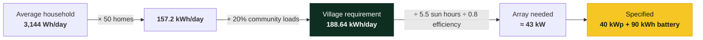

---

<a id="dashboard"></a>

## 📡 The live dashboard

The core feature: a control room that runs a **simulated day in Rampur Kheda**, minute by minute.

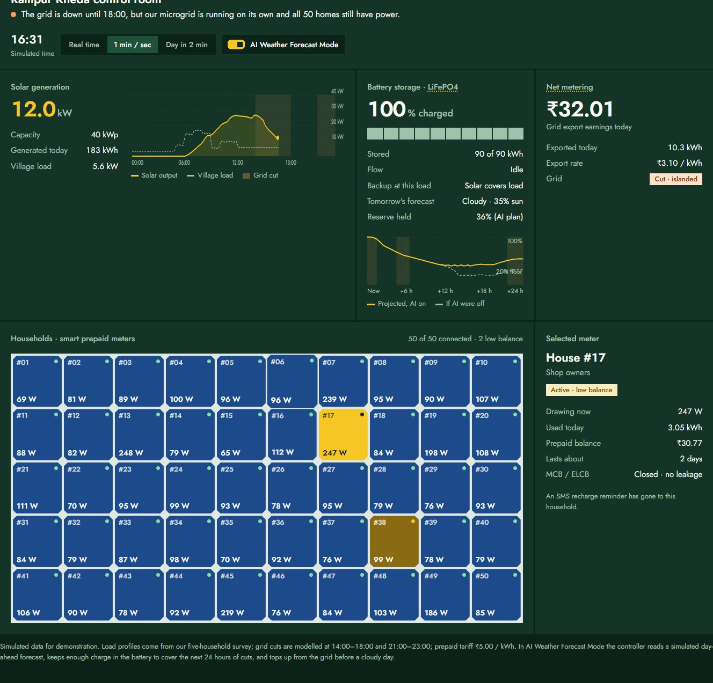

<table>
<tr>
<td width="62%" valign="top">

| Panel | What it shows |
| --- | --- |
| ☀️ **Solar generation** | Live kW output, energy generated today, and a chart of today's output against village load |
| 🔋 **Battery storage** | LiFePO4 state of charge, kWh stored, charging or supplying, and hours of backup at the current load |
| 💹 **Net metering** | Grid-export earnings ticking up through the day, kWh exported, and grid status (connected, exporting, or cut and islanded) |
| 🏠 **Household grid** | House #01–#50, laid out as the 50 cells of one solar panel, each with live draw and prepaid-meter status. Click a house to read its meter |

**Speed:** `Real time` · `1 min / sec` · `Day in 2 min`

</td>
<td width="38%" valign="top">
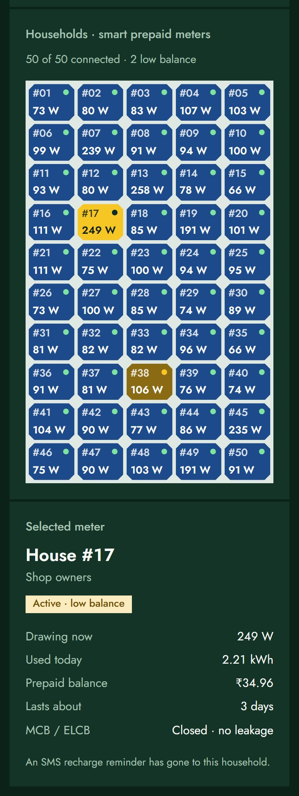
<div align="center"><sub>On a phone</sub></div>
</td>
</tr>
</table>

### What the simulation models

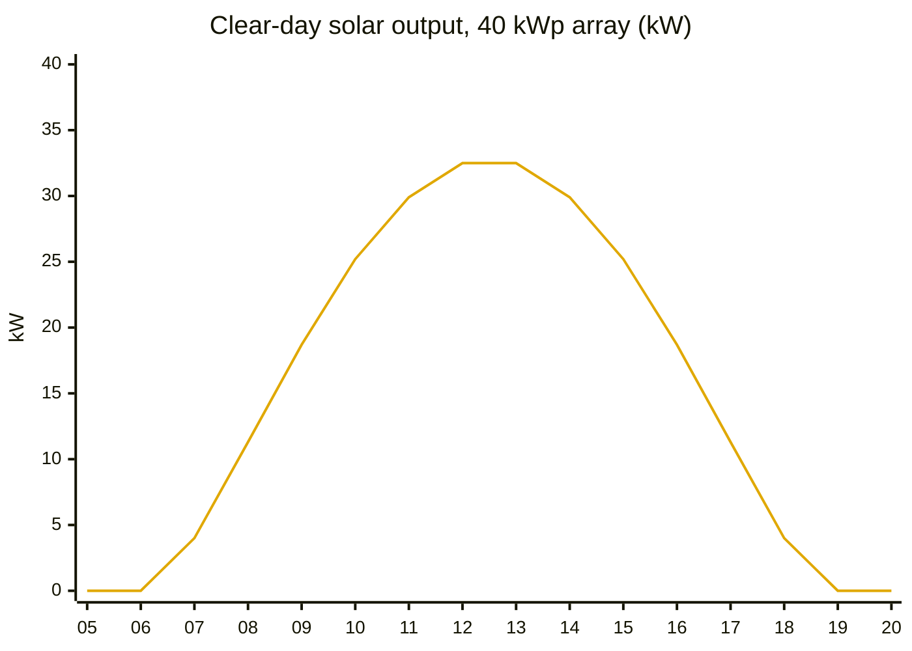

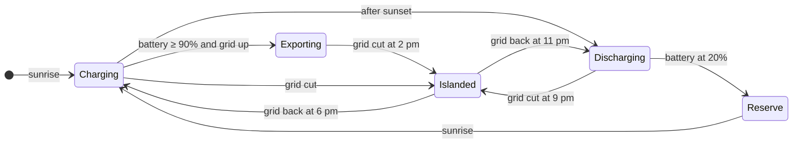

- **Solar:** a sun curve from about 06:15 to 18:45 at 82% system efficiency, with drifting clouds.
- **Loads:** the five surveyed household types, using their real appliance wattages and hours, spread across 50 homes, plus street lights and the shared water pump.
- **Battery:** 90 kWh, 92% round-trip efficiency, 20% reserve floor, 45 kW maximum charge rate.
- **Grid cuts:** 14:00–18:00 and 21:00–23:00. During a cut the microgrid islands and the battery carries every home.
- **Net metering:** surplus above 90% charge is exported at ₹3.10/kWh.
- **Prepaid meters:** balances fall at ₹5.00/kWh. Two homes start low so the recharge warning shows.

> [!NOTE]
> All dashboard data is **simulated** for demonstration. The tariffs and cut schedule are modelling assumptions, not measured figures.

---

<a id="system"></a>

## ⚙️ How the microgrid works

Power flows one way: from the array, through the central power house, out to every meter.

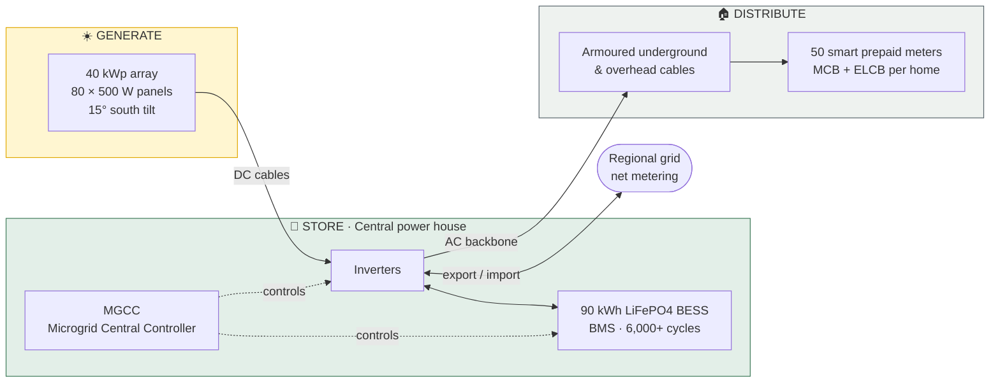

<table>
<tr>
<td width="33%" valign="top">
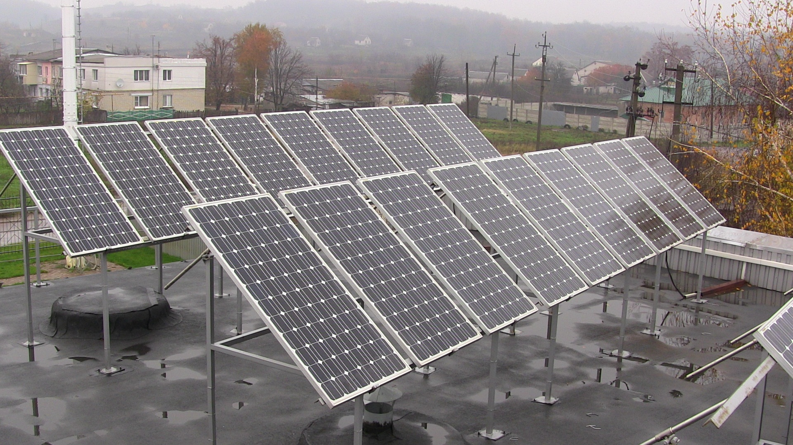

**Generate**<br>
80 × 500 W monocrystalline modules on ground mounts, in series-parallel strings. About 176 kWh on a clear day.
</td>
<td width="33%" valign="top">
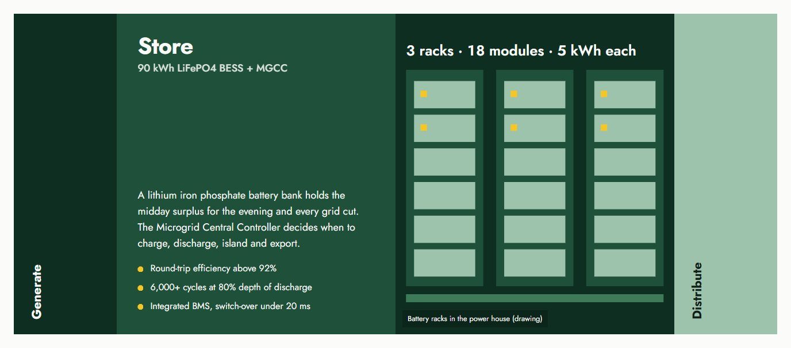

**Store**<br>
90 kWh LiFePO4 bank with an integrated BMS. Round trip above 92%, switch-over under 20 ms, run by the MGCC.
</td>
<td width="33%" valign="top">
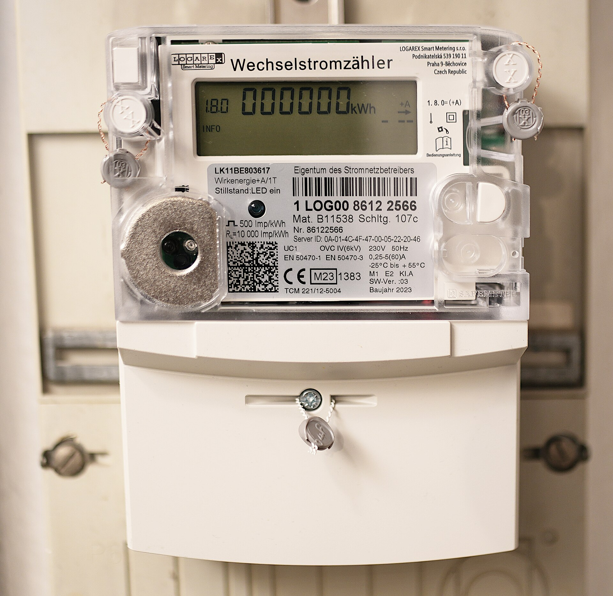

**Distribute**<br>
Armoured cables to every lane. Each home gets a smart prepaid meter, MCB and ELCB, with lightning arresters and earthing throughout.
</td>
</tr>
</table>

### The team's layout sketch

<div align="center">
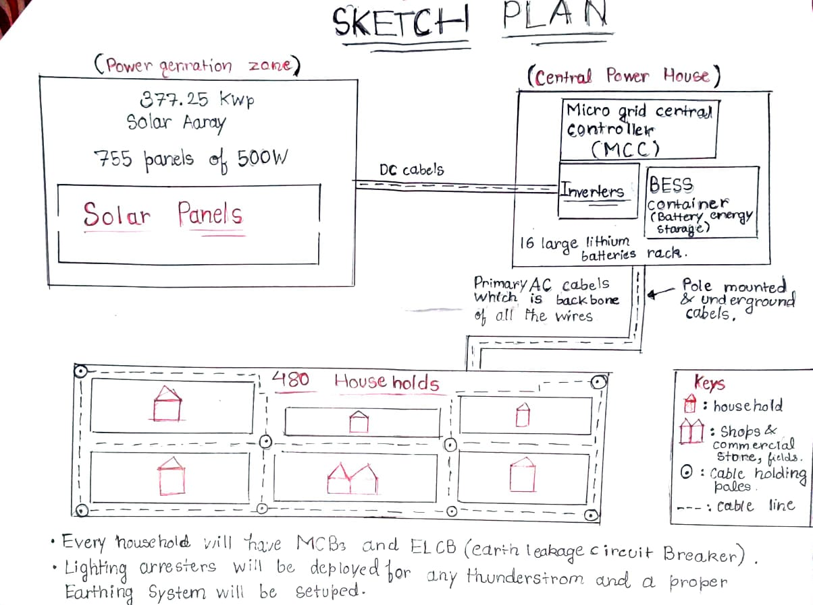
<br><sub>Hand-drawn by Team Pioneering Sol-Gen: generation zone, central power house, and the AC backbone on poles and underground to every home.</sub>
</div>

---

<a id="finances"></a>

## 💰 Financial transparency

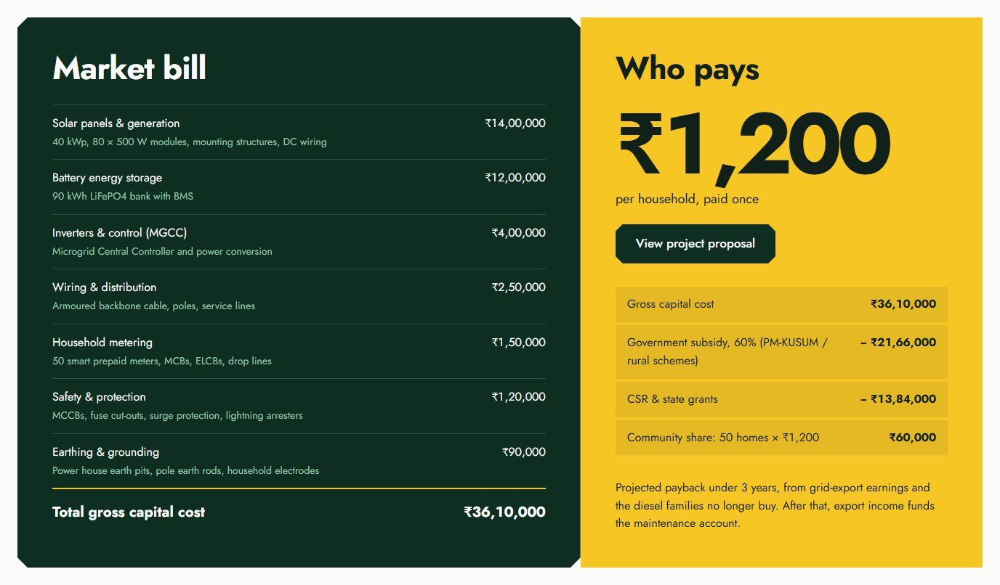

<table>
<tr>
<td width="50%" valign="top">

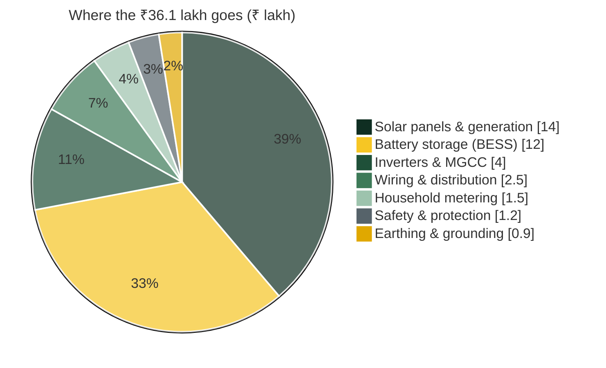

</td>
<td width="50%" valign="top">

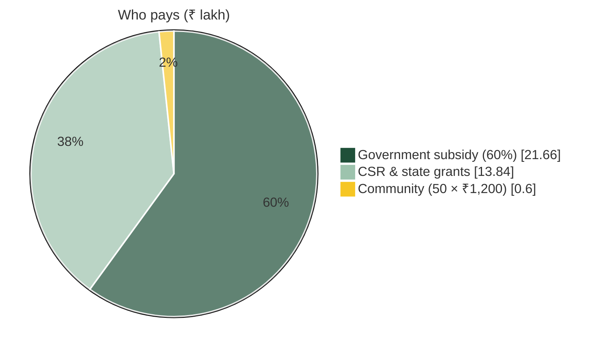

</td>
</tr>
</table>

| Item | Detail | Cost |
| --- | --- | ---: |
| Solar panels & generation | 40 kWp, 80 × 500 W modules, mounting structures, DC wiring | ₹14,00,000 |
| Battery energy storage | 90 kWh LiFePO4 bank with BMS | ₹12,00,000 |
| Inverters & control (MGCC) | Microgrid Central Controller and power conversion | ₹4,00,000 |
| Wiring & distribution | Armoured backbone cable, poles, service lines | ₹2,50,000 |
| Household metering | 50 smart prepaid meters, MCBs, ELCBs, drop lines | ₹1,50,000 |
| Safety & protection | MCCBs, fuse cut-outs, surge protection, lightning arresters | ₹1,20,000 |
| Earthing & grounding | Earth pits, pole earth rods, household electrodes | ₹90,000 |
| **Total gross capital cost** | | **₹36,10,000** |
| − Government subsidy, 60% | PM-KUSUM / rural schemes | ₹21,66,000 |
| − CSR & state grants | | ₹13,84,000 |
| **= Community share** | **50 homes × ₹1,200** | **₹60,000** |

The payback is projected at **under 3 years**, from grid-export earnings and the diesel families no longer buy. After that, export income funds the maintenance account.

---

## 🤝 Run by the village


<details>
<summary><b>❓ The tough questions from the pitch</b></summary>

<br>

**What happens during the monsoon or on cloudy days?**<br>
The battery keeps a reserve that bridges low-generation days, and monocrystalline panels still harvest diffuse light under cloud.

**What if households delay or fail to pay?**<br>
Smart prepaid meters pause supply when credit runs out, so no debt builds up. The committee handles hardship cases through peer accountability.

**Who handles breakdowns and daily maintenance?**<br>
A trained local lead technician runs weekly checks, backed by a professional annual maintenance contract for major components.

</details>

---

## 🧪 Prototype & innovation

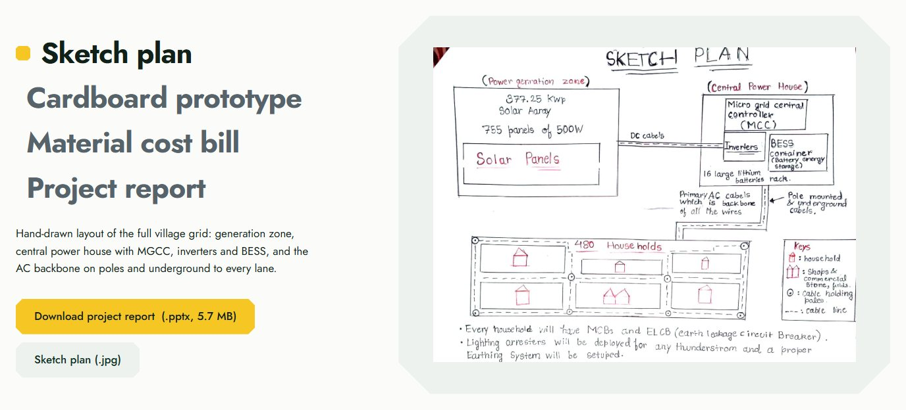

The gallery holds the team's **sketch plan**, the **cardboard prototype**, the prototype's **material cost bill**, and a download of the full **project report**.

---

## 🖥️ The website

<table>
<tr>
<td width="68%" valign="top">

### Design idea
The whole page runs on one shape: the **clipped-corner square of a monocrystalline solar cell**. It forms the buttons, tabs, image masks and tiles. In the dashboard, the 50 households become the 50 cells of a single solar panel.

| Colour | Hex | Use |
| --- | --- | --- |
|  Deep forest | `#0b2219` | Hero, dashboard, footer |
|  Forest | `#1f5039` | Fields and panels |
|  Sage | `#9dc3ad` | Secondary fields |
|  Crisp white | `#fbfcfa` | Page ground |
|  Slate | `#56636a` | Secondary text |
|  Solar yellow | `#f6c624` | Actions and live energy |

**Type:** [Jost](https://fonts.google.com/specimen/Jost), a 1920s geometric sans.

</td>
<td width="32%" valign="top">
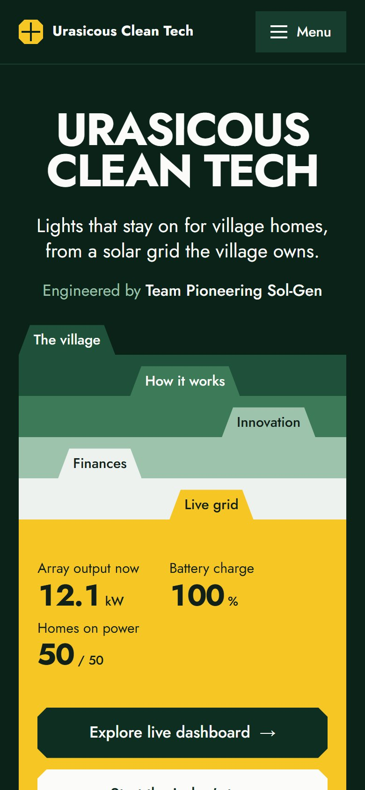
<div align="center"><sub>Fully responsive</sub></div>
</td>
</tr>
</table>

### Page sections

1. **Hero:** name, tagline, section folders, and live figures with *Explore live dashboard* and *View project proposal*
2. **The Rampur Kheda Initiative:** village profile, key figures, and the load survey
3. **Live microgrid dashboard:** the simulated control room
4. **Generate, store, distribute:** the three-stage architecture
5. **Financial transparency:** the market bill and who pays
6. **Run by the village:** governance and the pitch Q&A
7. **Prototype & innovation:** sketch, model, bill and report download
8. **Footer:** © 2026 Urasicous Clean Tech | Developed with passion by Team Pioneering Sol-Gen for HCL Jigsaw.

---

<a id="run"></a>

## 🚀 Running it

The site is plain HTML, CSS and JavaScript, with **no build step and no dependencies**.

```bash
git clone https://github.com/Roushan-2104/Urasicous-Clean-Tech.git
cd Urasicous-Clean-Tech
```

Open `index.html` in any browser, or serve the folder:

```bash
python -m http.server 8000
# then open http://localhost:8000
```

### Publish on GitHub Pages

1. Go to **Settings → Pages**.
2. Under **Build and deployment**, choose **Deploy from a branch**, then `main` and `/ (root)`.
3. The site goes live at `https://roushan-2104.github.io/Urasicous-Clean-Tech/`.

### Project structure

```
Urasicous-Clean-Tech/
├── index.html          # all page sections
├── styles.css          # design tokens, layout, responsive rules
├── app.js              # microgrid simulation, dashboard, interactions
├── assets/
│   ├── Village-Microgrid-Project-Report.pptx   # the team's worksheet
│   ├── sketch-plan.jpg                          # the team's layout sketch
│   ├── credits.json                             # source + licence of every photo
│   └── *.jpg                                    # openly licensed photographs
└── docs/screenshots/   # images used in this README
```

---

## 📝 Notes on the figures

- The headline figures (50 homes, 40 kWp, 90 kWh, ₹36.1 lakh, ₹1,200, under 3 years) follow the project brief. The village profile, load survey, battery specifications, governance model and pitch answers come from the team's worksheet.
- The worksheet also has a larger whole-village design (480 homes, 377 kWp, about ₹1.95 crore). The website presents the **50-household first phase**.
- The itemised bill splits ₹36.1 lakh across components at estimated market rates. The 60% subsidy is applied to the gross cost.
- The cardboard prototype appears as a drawing, and its material bill (₹900) is a sample. Both are to be replaced with the team's real photo and bill.

---

## 📷 Image credits

The photographs show the wider world of the project, not the project itself. All are from Wikimedia Commons under open licences:

| Photo | Author | Licence |
| --- | --- | --- |
| [Traditional House Solar, Zamtang, Zanskar](https://commons.wikimedia.org/w/index.php?curid=152914959) | Timothy A. Gonsalves | CC BY-SA 4.0 |
| [Anjenari village, Nashik](https://commons.wikimedia.org/w/index.php?curid=42551914) | Mahi29 | CC BY-SA 4.0 |
| [Rooftop solar power plant](https://commons.wikimedia.org/w/index.php?curid=44112543) | Oleg Savitsky | CC BY-SA 4.0 |
| [Logarex smart household electricity meter](https://commons.wikimedia.org/wiki/File:Logarex_smart_household_electricity_meter_build_year_2023.jpg) | RobbieIanMorrison | CC BY 4.0 |
| [Solar panels closeup](https://commons.wikimedia.org/wiki/File:Solar_panels_closeup.jpg) | Jollyroger | CC BY-SA 2.5 |
| [Bird's eye view of Nashik city](https://commons.wikimedia.org/w/index.php?curid=28498936) | Anannyadeb | CC BY-SA 3.0 |

The sketch plan and project report are the work of Team Pioneering Sol-Gen.

---

<div align="center">

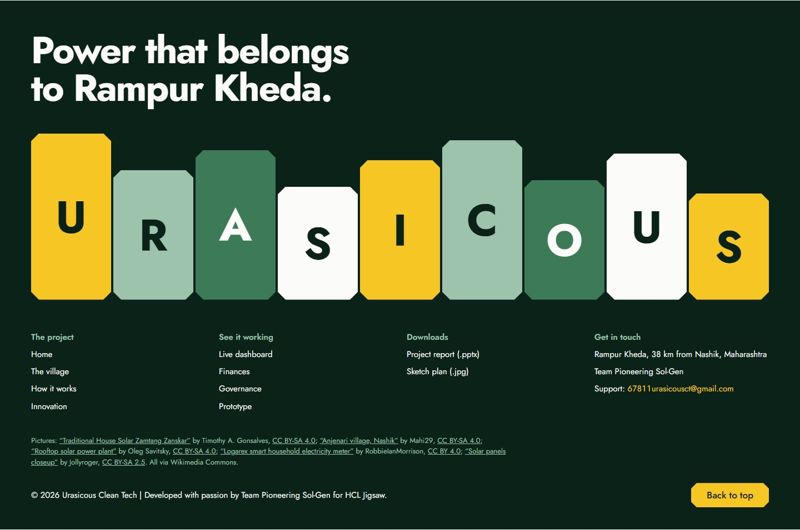

**© 2026 Urasicous Clean Tech** | Developed with passion by **Team Pioneering Sol-Gen** for **HCL Jigsaw**.<br>
<sub>Website built by <a href="https://github.com/Roushan-2104">Roushan</a></sub>

</div>
